
<picture><source media="(prefers-color-scheme: dark)" srcset="assets/matrix-header.svg"/></picture>

<picture><source media="(prefers-color-scheme: dark)" srcset="assets/boot.svg"/></picture>

<h2>⌁ ./arsenal</h2>

<picture><source media="(prefers-color-scheme: dark)" srcset="https://skillicons.dev/icons?i=js%2Cts%2Creact%2Cnodejs%2Cpython%2Cunity%2Ccs%2Ccpp%2Ctailwind%2Cvite%2Cmongodb%2Cpostgres%2Cdocker%2Cgit%2Clinux%2Cvercel&perline=8&theme=dark"/></picture>

<h2>⌁ cat /proc/jatin/stats</h2>

<picture><source media="(prefers-color-scheme: dark)" srcset="assets/stats.svg"/></picture>
<picture><source media="(prefers-color-scheme: dark)" srcset="assets/languages.svg"/></picture>

<h2>⌁ ls ~/classified/</h2>

<a href="https://github.com/anonymous-namo-1/spin-rumble"><picture><source media="(prefers-color-scheme: dark)" srcset="assets/dossier-spin-rumble.svg"/></picture></a>
<a href="https://github.com/anonymous-namo-1/blade-tilt"><picture><source media="(prefers-color-scheme: dark)" srcset="assets/dossier-blade-tilt.svg"/></picture></a> 
<a href="https://github.com/anonymous-namo-1/neon-fps"><picture><source media="(prefers-color-scheme: dark)" srcset="assets/dossier-neon-fps.svg"/></picture></a>
<a href="https://github.com/anonymous-namo-1/Battle-Royale-Core"><picture><source media="(prefers-color-scheme: dark)" srcset="assets/dossier-Battle-Royale-Core.svg"/></picture></a> 
<a href="https://github.com/anonymous-namo-1/neon-deceit-game"><picture><source media="(prefers-color-scheme: dark)" srcset="assets/dossier-neon-deceit-game.svg"/></picture></a>
<a href="https://github.com/anonymous-namo-1/SIH26151-Threat-Intelligence-1"><picture><source media="(prefers-color-scheme: dark)" srcset="assets/dossier-SIH26151-Threat-Intelligence-1.svg"/></picture></a> 
<a href="https://github.com/anonymous-namo-1/synth-eight"><picture><source media="(prefers-color-scheme: dark)" srcset="assets/dossier-synth-eight.svg"/></picture></a> 

<!-- Contribution snake + 3D graph: enable after adding .github/workflows (needs a token with `workflow` scope)

-->

<!-- Spotify now playing: deploy https://github.com/novatorem/novatorem to Vercel with SPOTIFY_CLIENT_ID / SPOTIFY_SECRET_ID / SPOTIFY_REFRESH_TOKEN, then uncomment:

-->

<h2>⌁ fortune | cowsay</h2>

<picture><source media="(prefers-color-scheme: dark)" srcset="https://quotes-github-readme.vercel.app/api?type=horizontal&theme=dark"/></picture>

<picture><source media="(prefers-color-scheme: dark)" srcset="assets/footer.svg"/></picture>

cards self-hosted in <code>assets/</code> · regenerate with <code>python3 scripts/gen_cards.py</code>
