<h2>⌁ ./arsenal</h2>

<h2>⌁ cat /proc/jatin/stats</h2>

<h2>⌁ ls ~/classified/</h2>

 

 

 
 

<!-- Contribution snake + 3D graph: enable after adding .github/workflows (needs a token with `workflow` scope)

-->

<!-- Spotify now playing: deploy https://github.com/novatorem/novatorem to Vercel with SPOTIFY_CLIENT_ID / SPOTIFY_SECRET_ID / SPOTIFY_REFRESH_TOKEN, then uncomment:

-->

<h2>⌁ fortune | cowsay</h2>

cards self-hosted in <code>assets/</code> · regenerate with <code>python3 scripts/gen_cards.py</code>
