<a href="https://github.com/anonymous-namo-1?tab=repositories">
<picture>
  <source media="(prefers-color-scheme: dark)" srcset="assets/scene.svg"/>
  
</picture>
</a>

<a href="https://github.com/anonymous-namo-1/spin-rumble">spin-rumble</a> ·
<a href="https://github.com/anonymous-namo-1/blade-tilt">blade-tilt</a> ·
<a href="https://github.com/anonymous-namo-1/neon-fps">neon-fps</a> ·
<a href="https://github.com/anonymous-namo-1/Battle-Royale-Core">battle-royale-core</a> ·
<a href="https://github.com/anonymous-namo-1/neon-deceit-game">neon-deceit</a> ·
<a href="https://github.com/anonymous-namo-1/synth-eight">synth-eight</a> ·
<a href="https://github.com/anonymous-namo-1/SIH26151-Threat-Intelligence-1">threat-intel</a>

